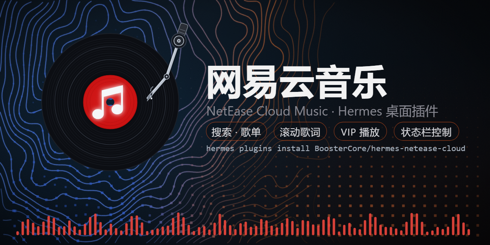
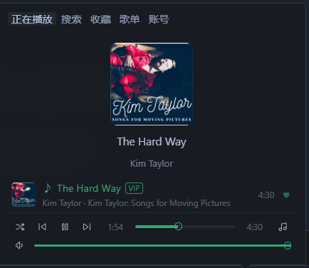
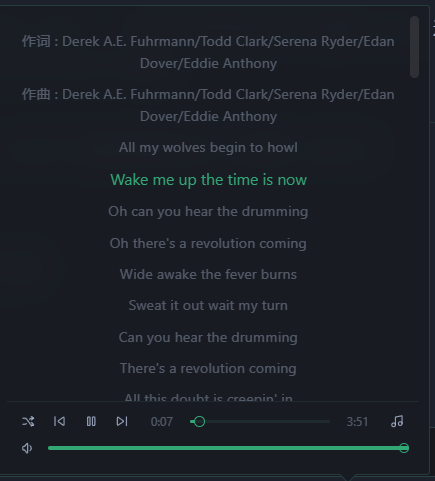
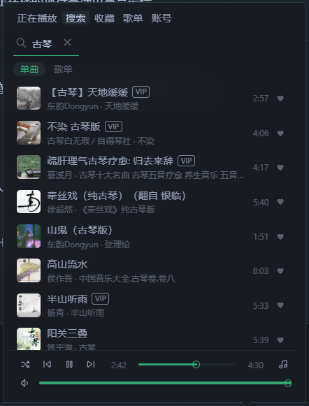
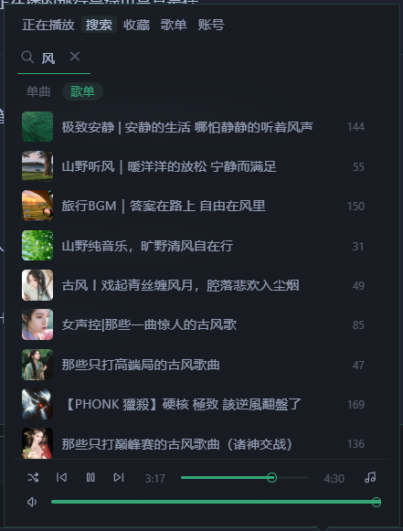
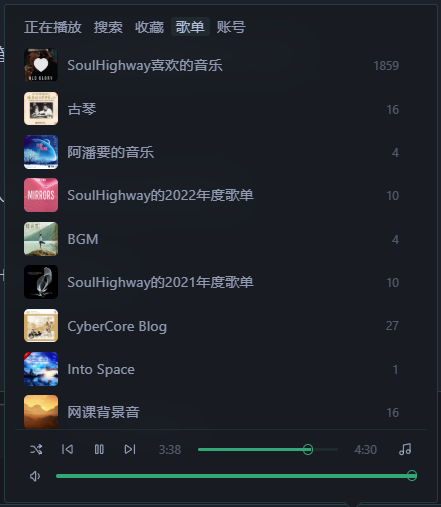
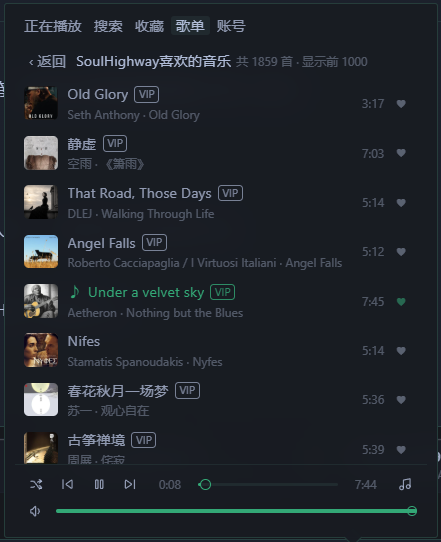

# NetEase Cloud Music · 网易云音乐

**English** · [简体中文](README.zh-CN.md)

A minimal NetEase Cloud Music player for the Hermes Desktop status bar, in the
spirit of the built-in Radio plugin.

> **Disclosure**
>
> The plugin's local backend calls NetEase Cloud Music public web endpoints
> (`music.163.com`, `interface3.music.163.com`, and the `p*.music.163.com`
> CDNs) for search, playlists, lyrics and playable audio URLs.
> **No other third-party services and no telemetry.**
>
> **Stored credential:** after you log in, your NetEase session cookie
> (`MUSIC_U`) is stored in the plugin's own data directory
> (`data/cookie.json`, git-ignored). "Log out" deletes it. The cookie is sent
> only to NetEase hosts; it is never passed to any other service. VIP songs
> stream through this session. QR login may be blocked by NetEase risk
> control; pasting the `MUSIC_U` cookie is the reliable fallback.
>
> No build step, no Python dependencies beyond what Hermes already ships
> (FastAPI) — NetEase's weapi/eapi crypto (AES-CBC/ECB + RSA) is implemented
> with the standard library only.

## Features

- 🔎 **Search** songs and playlists (two tabs: Songs / Playlists)
- ▶️ **Playback controls**: play / pause / previous / next, progress bar,
  volume — all in a consistent thin-outline style
- 📜 **Scrolling synced lyrics** with the current line highlighted
- ❤️ **Favorites**: heart / un-heart, and the "Liked Music" playlist
- 📁 **My Playlists**: browse your own NetEase playlists and play them
  right inside the panel
- 🔑 **Login**: QR code **or** paste your `MUSIC_U` cookie (QR login is often
  blocked by NetEase risk control — the cookie is the reliable fallback)
- 🔁 **Play modes**: list loop / single loop / shuffle
- 🖥️ **Status bar**: mini controls on the bottom status bar plus a compact
  popover panel; follows the Hermes theme, no build step

## Install

```bash
hermes plugins install BoosterCore/hermes-netease-cloud
hermes plugins enable netease-cloud
```

Then enable **NetEase Cloud Music** under **Capabilities → Plugins**.
VIP tracks require a logged-in NetEase VIP account.

## Login (pick one)

**Option A · QR code** — open the 账号 (Account) tab and scan with the
NetEase Cloud Music app. If you see "检测到当前设备环境异常，本次操作已拦截"
(risk control), use Option B.

**Option B · Cookie (recommended, most reliable)**
1. Log in to [music.163.com](https://music.163.com) in a desktop browser
2. Open DevTools (F12) → Application/Storage → Cookies → copy the **value** of
   `MUSIC_U`
3. Paste it into the input on the 账号 (Account) tab and hit import
   (pasting the full cookie string also works; if you accidentally paste
   `NMTID` the plugin will tell you)

## Screenshots



| Now Playing | Lyrics | Search · Songs |
|---|---|---|
|  |  |  |

| Search · Playlists | My Playlists | Playlist Tracks |
|---|---|---|
|  |  |  |

## Known limitations

- Playlists load the first 1000 tracks (the panel shows the real total)
- Audio quality follows your NetEase account (VIP → higher bitrate); the
  plugin requests `exhigh` and falls back to `standard` when unavailable
- QR login may be blocked by NetEase risk control ("environment anomaly") —
  use cookie login instead

## Repository layout

```
netease-cloud/
├── plugin.yaml            # Hermes plugin manifest
├── dashboard/
│   ├── manifest.json      # backend API declaration
│   └── plugin_api.py      # FastAPI routes: search / url / lyric / login ...
└── desktop/
    └── plugin.js          # Desktop status-bar UI (single-file ESM, @hermes/plugin-sdk)
```

## License

MIT
