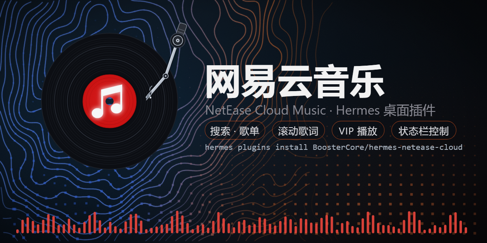
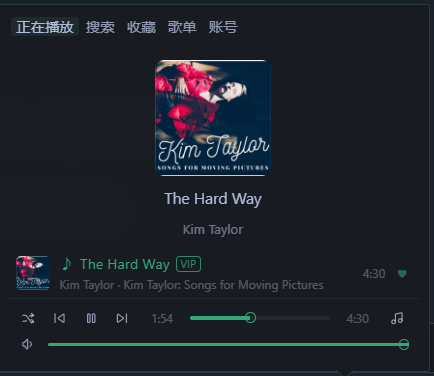
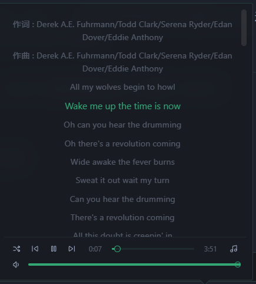
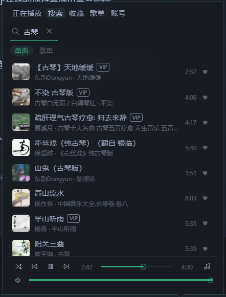
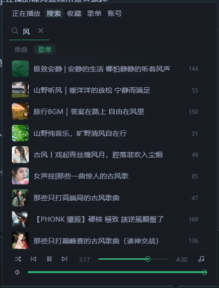
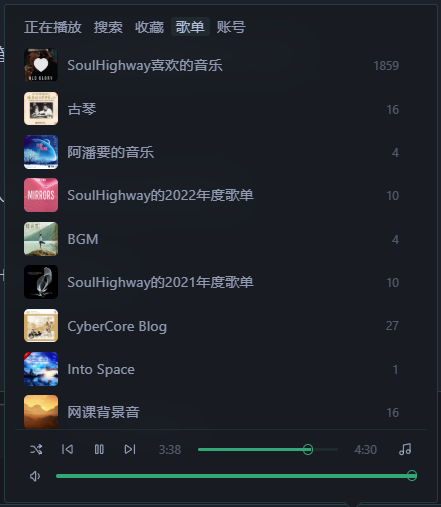
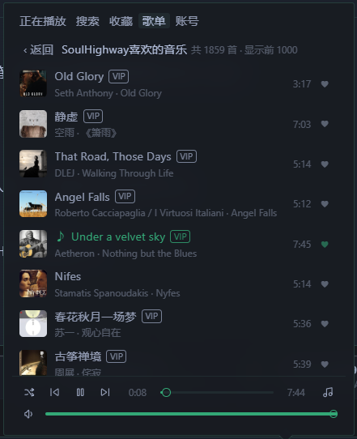

# 网易云音乐 · NetEase Cloud Music

[English](README.md) · **简体中文**

一个运行在 Hermes 桌面版底部状态栏的极简网易云音乐播放器，交互方式与内置的 Radio 插件同源。

> **数据与隐私说明**
>
> 插件的本地后端只调用网易云音乐的公开网页接口（`music.163.com`、
> `interface3.music.163.com` 和 `p*.music.163.com` CDN），用于搜索、歌单、
> 歌词和取播放地址。**不请求任何其他第三方服务，无遥测。**
>
> **存储的凭据：** 登录后，你的网易云会话 Cookie（`MUSIC_U`）保存在插件自己的
> 数据目录（`data/cookie.json`，已 git-ignore）。点「退出登录」即删除。
> 该 Cookie 只发给网易云的域名，绝不传给其他任何服务。VIP 歌曲用这个会话播放。
> 扫码/短信登录可能被网易风控拦截，面板会给出官方验证页链接；粘贴 `MUSIC_U` Cookie 仍是兜底方案。
>
> 无需构建，除 Hermes 自带的 FastAPI 外没有额外 Python 依赖——
> 网易云 weapi/eapi 加密（AES-CBC/ECB + RSA）全部用 Python 标准库实现。

## 功能一览

- 🔎 **搜索** 单曲与歌单（单曲 / 歌单 双标签）
- ✨ **推荐页**（需登录）：每日推荐（每天 30 首）、私人 FM、推荐歌单——含官方「私人雷达」
- ▶️ **播放控制**：播放 / 暂停 / 上一首 / 下一首、进度条、音量（统一镂空细线风格）
- 📜 **滚动歌词**：自动高亮当前行
- ❤️ **收藏**：状态栏一键红心（官方播放器同款点按切换）或任意歌曲行收藏 / 取消，「喜欢的音乐」歌单
- 📁 **我的歌单**：浏览并直接在面板内播放自己的网易云歌单
- 🔑 **登录**：扫码 / 手机号+短信验证码 / 粘贴 `MUSIC_U` Cookie（扫码与短信都可能被网易风控拦截，面板会给出官方验证页入口；Cookie 是最稳的兜底方案）
- 🔁 **播放模式**：列表循环 / 单曲循环 / 随机播放
- 🖥️ **状态栏**：底部状态栏迷你控制（含随音乐频谱跳动的点阵可视化）+ 紧凑弹出面板，跟随 Hermes 主题，无需构建
- 💿 **唱片化播放界面**：正在播放封面以黑胶唱片形式旋转，带联动折角唱臂（播放落盘、暂停回架）；
  当前曲目在所有列表中显示为迷你转动小唱片

## 安装

```bash
hermes plugins install BoosterCore/hermes-netease-cloud
hermes plugins enable netease-cloud
```

然后在 **Capabilities → Plugins（能力 → 插件）** 里打开「网易云音乐」。
VIP 歌曲需要已登录的网易云 VIP 账号。

## 登录教程（三选一）

**方式 A · 扫码登录**
进入「账号」标签 → 用网易云音乐 App 扫码。若提示「检测到当前设备环境异常，本次操作已拦截」，说明被风控拦截，请改用方式 B。

**方式 B · 短信验证码登录**
进入「账号」标签 → 输入手机号 → 点「发送验证码」→ 填入收到的 6 位验证码 → 登录。
若提示「8810 网络环境存在安全风险」，点面板上的「打开验证页面」按钮，在浏览器里完成官方人机验证，**约 24 小时后再试**（期间不要反复点发送/登录，会加深风控标记）。

**方式 C · Cookie 登录（推荐，最稳）**
1. 在电脑浏览器登录 [music.163.com](https://music.163.com)
2. 按 F12 打开开发者工具 → Application/存储 → Cookies → 找到 `MUSIC_U` 这一项，复制它的**值**
3. 回到插件「账号」标签，把值粘贴进输入框，点导入即可
   （直接粘贴整串 Cookie 也可以；若误粘了 `NMTID`，插件会提示你）

## 界面截图



| 正在播放 | 滚动歌词 | 搜索·单曲 |
|---|---|---|
|  |  |  |

| 搜索·歌单 | 我的歌单 | 歌单内播放 |
|---|---|---|
|  |  |  |

## 已知限制

- 超大歌单载入前 1000 首（面板会显示真实总首数）
- 音质跟随你的网易云账号（VIP → 更高码率）；插件优先请求 `exhigh`，不可用时回退 `standard`
- 扫码/短信登录可能被网易风控拦截（「环境异常」/「安全风险」）：点面板上的「打开验证页面」完成官方验证，或改用 Cookie 登录

## 目录结构

```
netease-cloud/
├── plugin.yaml            # Hermes 插件清单
├── CHANGELOG.md           # 版本变更记录（英文；中文见 CHANGELOG.zh-CN.md）
├── dashboard/
│   ├── manifest.json      # 后端 API 声明
│   └── plugin_api.py      # FastAPI 路由：search / recommend / url / lyric / like / login ...
└── desktop/
    ├── src/               # 界面源码（plugin.src.js + qrlib.js）
    └── plugin.js          # 构建产出的状态栏 UI（单文件 ESM，@hermes/plugin-sdk）
```

## 许可

MIT
